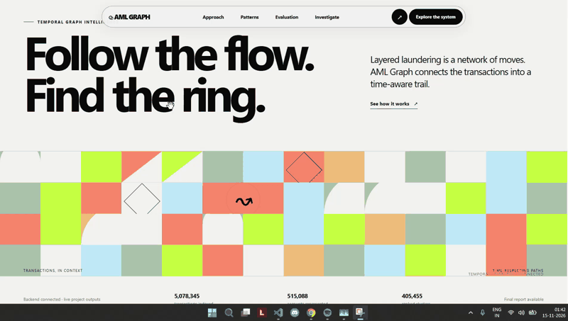
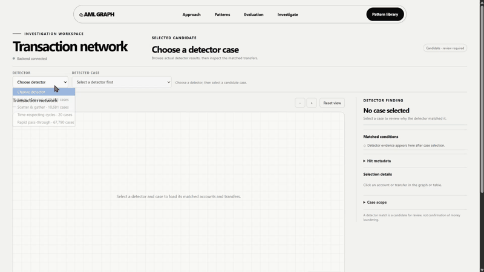

# AML Graph

[](https://www.python.org/)
[](#run-tests)
[](#dataset)
[](#current-limitations)

AML Graph is a prototype for spotting suspicious patterns across connected bank transfers. It groups transfers into temporal graph patterns, shows the accounts and evidence behind each candidate, and lets you replay the transfer sequence. A flagged result is a **candidate to review**; it does not prove that money laundering happened.

The implemented contribution is a temporal multigraph pipeline that preserves parallel transfers and orders equal-time events by transaction ID, then combines four deterministic pattern detectors with evidence-linked alerts and a learned cluster risk scorer. The interface lets a reviewer inspect the matched transfers and replay their order. This combines established graph-pattern ideas into a reproducible prototype; it is not a claim of a new AML algorithm or validated banking product.

The four detector commands map to these patterns: `fan` detects fan-in (many accounts sending to one account) and fan-out (one account sending to many); `scatter_gather` detects scatter-gather and gather-scatter layering; `cycle` detects time-ordered loops; and `pass_through` detects rapid transfer chains.



## Results

Final test results on the HI-Small synthetic benchmark. Account metrics are the overall graph-system result; attempt recall is reported per benchmark pattern at 50% edge coverage. “Not covered” means the current detectors do not evaluate that typology.

<!-- | Scope | Precision | Recall | F1 / attempt recall |
|---|---:|---:|---:|
| Overall account | 10.9% | 24.8% | F1 15.1% |
| Cycle attempts (5/10) | — | — | 50.0% |
| Fan-in attempts (2/12) | — | — | 16.7% |
| Fan-out attempts (0/10) | — | — | 0.0% |
| Gather-scatter attempts (0/16) | — | — | 0.0% |
| Scatter-gather attempts (9/11) | — | — | 81.8% |
| Stack attempts (0/7) | — | — | 0.0% |
| Bipartite (17 attempts), Random (12 attempts) | — | — | Not covered | -->

The test contained 1,015,882 transactions, including 1,798 labeled positive transactions, and 95 attempts starting in the test period. These are synthetic benchmark results, not evidence of real-world effectiveness. The investigation replay below shows the kind of evidence the prototype presents for a candidate.



## Clone and install

```bash
git clone https://github.com/tanishshadow/kajukatli kajukatli
cd kajukatli
python3 -m venv .venv
source .venv/bin/activate
pip install -e .
```

```powershell
git clone https://github.com/tanishshadow/kajukatli kajukatli
cd kajukatli
py -3.13 -m venv .venv
.\.venv\Scripts\Activate.ps1
python -m pip install -e .
```

## Dataset

Get the HI-Small dataset from either [Kaggle](https://www.kaggle.com/datasets/berkanoztas/transactions-data) or [IBM's dataset page](https://github.com/IBM/AML-Data). Kaggle may require an account. The current preparation step requires these files in the project root:

```text
HI-Small_Trans.csv
HI-Small_Patterns.txt
```

`HI-Small_accounts.csv` is optional. Raw files remain unchanged. Prepare the processed files with:

```bash
aml prepare --config backend/configs/default.yaml
```

## Run the local demo

Create detector results for the investigation page:

```bash
aml detect --detector fan --config backend/configs/default.yaml
aml detect --detector scatter_gather --config backend/configs/default.yaml
aml detect --detector cycle --config backend/configs/default.yaml
aml detect --detector pass_through --config backend/configs/default.yaml
```

Start the combined backend and website:

```bash
aml web --config backend/configs/default.yaml
```

Open **http://127.0.0.1:8765/** or go directly to **http://127.0.0.1:8765/investigation.html**. The backend runs locally; it is not hosted. The full pipeline and case data are available when you prepare the HI-Small dataset and run the detector commands above. On Windows, press `Ctrl+C` in PowerShell to stop the server. To use another port, add `--port 8766`.

The investigation page requires the local backend and detector outputs. When you run `aml web`, the backend reads locally prepared transaction files and detector outputs, then fetches only the selected case's transfers for the graph. It does not send the full dataset to your browser. The graph shows accounts, transfers, timing, detector evidence, and benchmark labels.

## Run tests

After activating the virtual environment, run:

```bash
pytest -q
```

```powershell
python -m pytest -q
```

There is no automated CI workflow configured yet, so the badge above reports that status instead of implying a passing hosted build. The checks can be run locally with the commands shown here.

## Evaluation integrity

The system uses a temporal split: train data sets detector/model parameters, validation data selects the alert cutoff, and the frozen setup is measured on the final test period. `aml report` performs that final evaluation and is guarded against a second run under a changed configuration. Avoid running it casually; use the saved report and the [Evaluation page](http://127.0.0.1:8765/evaluation.html) for existing results.

### Test-period disclosure

The test period was evaluated twice before the one-run safeguard was added. After the first run, scoring and evasion settings changed and score-report formatting was updated. The earlier outputs are kept under `outputs/m11/archived_exploratory/` and are exploratory, not the final result. Those earlier files did not record a configuration hash, so an exact before-and-after hash comparison is unavailable. The current final report was run with the frozen configuration recorded by the project.

## Current limitations

- HI-Small is synthetic; real-world effectiveness has not been established.
- Some evaluation comparisons are unfinished. The saved final report is reduced; missing comparisons should not be interpreted as passing.
- Some benchmark typologies are not covered, and recall varies by pattern.
- Summaries use an offline deterministic template; no outside AI service or API key is connected.
- Very large detected cases may be shortened in the graph view; the page reports when transfers are omitted.

## Data credit

The HI-Small benchmark comes from IBM's synthetic financial-transactions work. See the [research paper](https://proceedings.neurips.cc/paper_files/paper/2023/hash/5f38404edff6f3f642d6fa5892479c42-Abstract-Datasets_and_Benchmarks.html) and IBM's [dataset information and license](https://github.com/IBM/AML-Data/blob/main/README.md) before sharing the dataset or a hosted copy. Raw data and generated results are excluded from Git.
